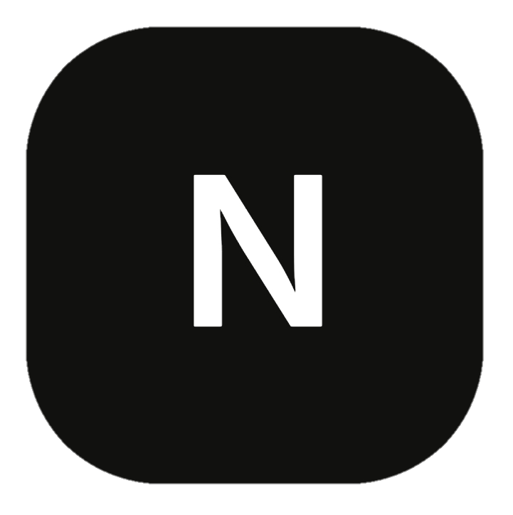
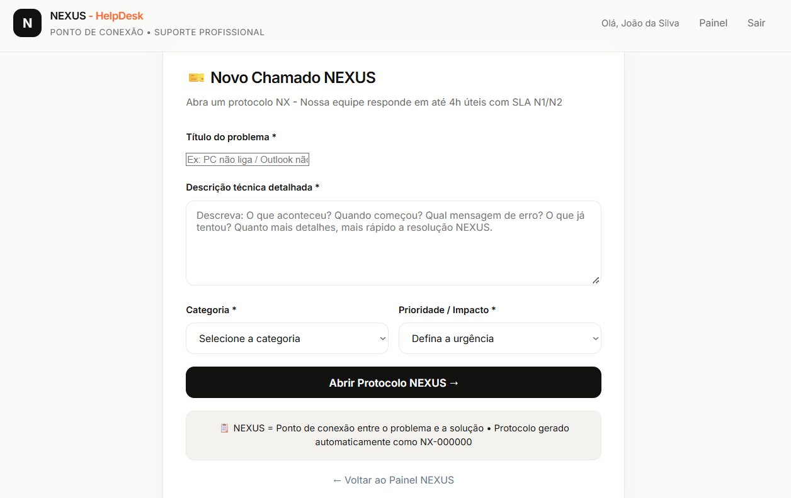
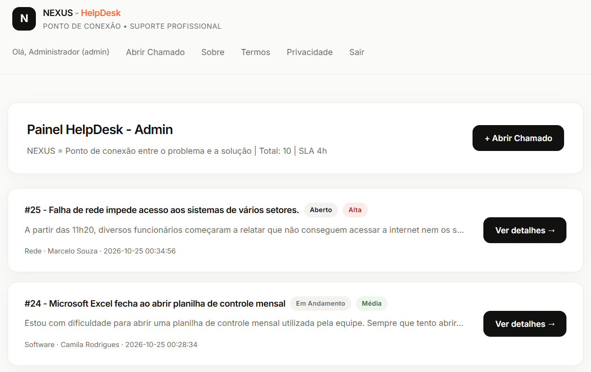

<div align="center">



# NEXUS - HelpDesk
### Ponto de Conexão entre o Problema e a Solução


[](https://php.net)
[](https://mysql.com)
[](https://helpdesk-nexus-lac.vercel.app)


**[🔗 DEMO AO VIVO](https://helpdesk-nexus-lac.vercel.app) • [📸 Screenshots](#-preview) • [🚀 Funcionalidades](#-funcionalidades-premium)**

</div>

---

## 💡 Por que NEXUS?

> **NEXUS** vem do latim: *ponto central onde tudo se conecta*.
> É um termo usado em infraestrutura de redes para definir o ponto de interconexão. Meu sistema é exatamente isso: **o elo que conecta o problema do usuário à solução técnica, com protocolo NX, chat e SLA.**

---

## 👀 Preview

<div align="center">

| Dashboard Cliente | Painel Admin NEXUS |
| :---: | :---: |
|  |  |
| *Abertura de Chamados* | *Possibilidade de Exclusão ou Edição do Chamado* |

</div>

## 🚀 Funcionalidades Premium

### 🔐 Autenticação Segura NEXUS
- Login com `password_hash` + compatibilidade automática `md5 -> bcrypt`
- Proteção com `prepared statements` contra SQL Injection
- Saída escapada contra XSS e cookies de sessão `httponly` e `secure`
- Sessão com controle de permissão (admin só vê tudo, usuário só vê seus chamados)
- Termos de Uso e Política de Privacidade (LGPD), com aceite antes do login

### 🎫 Gestão de Chamados Enterprise
- **Protocolo NEXUS:** Todo chamado gera `NX-000001`, `NX-000002`...
- Categorias: Suporte Técnico, Rede, Software, Hardware, E-mail, Impressora
- Prioridades com badge colorido: 🟢 Baixa | 🟡 Média | 🔴 Alta
- Status: Aberto / Em Andamento / Fechado
- **SLA de 4h úteis** informado ao cliente no sistema
- Horário de Brasília (`America/Sao_Paulo`) em todo o sistema

### 💬 Chat em Tempo Real
- Conversa estilo WhatsApp dentro do chamado
- Mensagens diferenciadas: Admin (azul degradê) vs Usuário (branco)
- Histórico completo salvo no banco `chamado_mensagens`
- Atualização automática a cada 2 segundos
- Auto-scroll para última mensagem

### 🛠️ Painel Admin Profissional
- Visualizar todos os chamados com nome do solicitante
- Atualizar status com 1 clique
- Excluir chamados com confirmação (cascade delete)
- Design responsivo 100% mobile

### 🎨 UI/UX Profissional
- Marca fictícia **NEXUS - HelpDesk** com logo N estilizada (degradê + sombra)
- Header sticky com separador `|` entre links
- Design System com variáveis CSS `:root` e animações suaves
- 100% responsivo com grid adaptativo

---

## 🛠️ Stack

<div align="center">

| Camada | Tecnologias |
| :--- | :--- |
| **Backend** | PHP 8.2 • MySQL 8 • MySQLi Prepared Statements |
| **Frontend** | HTML5 • CSS3 Moderno (Flex/Grid) • Inter Font • Animações |
| **Segurança** | Bcrypt • MD5 Migration • Session Control |
| **Infra** | Vercel • Git • Protocolo NX |

</div>

---

## 🔑 Acesso de Teste

<div align="center">

| Perfil | Email | Senha | Acesso |
| :---: | :---: | :---: | :---: |
| **👨‍💻 Admin (Técnico N2)** | `admin@nexus.com` | `admin123` | Vê todos os chamados, responde e exclui |
| **👤 Usuário (Cliente)** | `guilherme@teste.com` | `123` | Abre e acompanha seus chamados |

</div>

> **Fluxo de teste:** logue como cliente → abra o chamado "PC sem internet" → saia → logue como admin → responda no chat → volte como cliente e veja a resposta.

---

## 📸 Como usar

```bash
# 1. Clone o repositório
git clone https://github.com/guilherme-medeiros-oliveira/helpdesk-nexus.git
cd helpdesk-nexus

# 2. Importe o banco (helpdesk.sql)
# 3. Configure o config.php com seu MySQL (use o config_exemplo.php como modelo)
# 4. Acesse index.php

# Estrutura do Banco:
# usuarios (id, nome, email, senha, tipo)
# chamados (id, usuario_id, titulo, descricao, categoria, prioridade, status, data_abertura)
# chamado_mensagens (id, chamado_id, usuario_id, mensagem, data_envio)
```

---

## 👨‍💻 Autor

<div align="center">


### Guilherme Medeiros

*Estudante de Análise e Desenvolvimento de Sistemas | Em busca de vaga Help Desk / Suporte N1/N2*

[LinkedIn](https://www.linkedin.com/in/guilherme-medeiros-oliveira-478b45291) | [Portfolio](https://github.com/guilherme-medeiros-oliveira/) | [Email](mailto:medeiros.oliveira.guilherme@gmail.com)


> **NEXUS** = Ponto de conexão entre o problema e a solução. Meu código conecta usuário à resolução com SLA, histórico e experiência profissional.

⭐ *Se você curtiu esse projeto, deixa uma estrela!*

</div>
